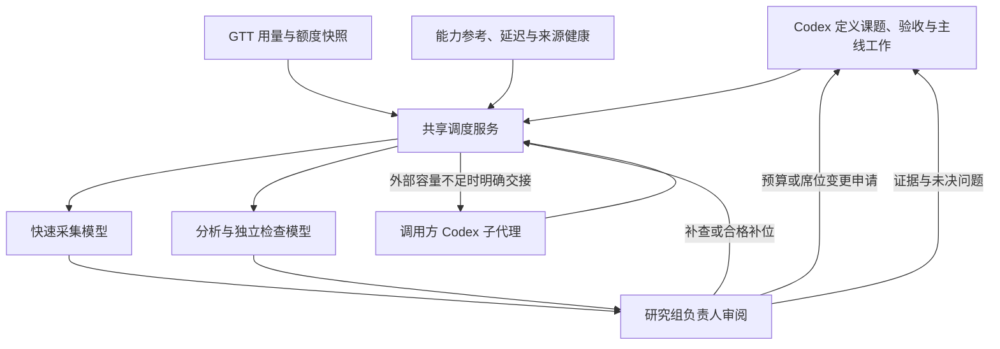

# GTT Model Coordinator

让 Codex 根据任务需要，协调本机已配置的 coding 软件和模型：快速模型负责资料收集，较强模型负责分析与局部评审，研究组负责人审阅证据，Codex 保留统筹、独立核对与最终质量把关。

本仓库包含 `gtt-coordinator` Skill、Python 标准库 MCP 服务、原生软件适配器、测试和 GTT 接口资料。调度器优先使用合格的外部模型，结合任务类型、能力参考、实测延迟、额度、并发和来源健康选择路线；外部容量不足时，才提出调用方 Codex 子代理接力。

| 工作方式 | 适合的工作 | 回收方式 |
|---|---|---|
| 普通任务 | 有界检索、材料提取、整理、局部评审、逻辑检查与互证 | 提交后继续主线，按 cursor 回收短报告 |
| 分组研究 | 多阶段、长程、需要分工与来源互证的课题 | 自适应 3–8 个角色，由负责人续研、补位或提交 Codex 终审 |

入口：[安装](#安装) · [开始使用](#开始使用) · [分组研究](#分组研究) · [预算与并发](#预算与并发) · [用量统计](#用量统计) · [扩展与升级](#扩展与升级) · [常见问题](#常见问题)

## 协同方式



使用同一配置的 MCP 客户端共用本机驻留服务、容量和状态库。关闭一个客户端不会取消其他客户端的作业。Codex 自身子代理通过短期租约登记真实状态与 `work_key`，避免重复分工，并计入合计并发。

能力评分用于选路。不同 Terminal-Bench 版本、harness、模型版本和思考档分别处理；模型目录、榜单分数或一次成功生成都不能代替对任务结果的核对。

## 可接入的来源

| 来源 | 适配器 | 调度范围 |
|---|---|---|
| ZCode | `zcode_rpc` | 已配置 provider / model / effort 路线；解析原生输出范围 |
| Antigravity 独立 CLI | `antigravity_cli` | 有界网络检索、页面摘录和缓存读取，使用协调器专用项目 |
| OpenCode | `opencode_http` | 全部已连接 provider 下的合格文本模型及已枚举推理变体，保留同名模型的不同 provider |
| Claude Code | `claude_cli` | 原生固定模型或家族别名，通过 print / stream-json 调用 |
| WorkBuddy 内置 CodeBuddy CLI | `codebuddy_cli` | 原生 headless 入口和软件公布的模型列表 |
| DSH Desktop | `dsh_headless` | 已支持适配；默认注册仅记录已安装，因可能消耗自有 API 余额而不自动接入执行 |
| 其他软件或服务 | `command_json` | 注册命令桥接，沿用统一输入、输出、取消与用量契约 |
| Codex 原生子代理 | 调用方交接 | 调用方使用真实协作工具执行，并回报实际模型、结果与用量 |

OpenCode 的默认模型不是可调度模型的全部。目录来自原生已连接 provider；未认证、弃用、禁用或明确不支持文本输出的模型不会因名称存在就成为合格路线。软件被 GTT 扫描到，也不代表已有可执行适配器。详见 [原生 agent 接入](docs/native-agents.md)。

## 安装

### 1. 准备运行环境

需要 Python 3.10+，以及各来源已经安装、完成认证的原生客户端和运行时。ZCode 入口还需要现有 Node.js。生产 MCP 服务只用 Python 标准库；官方 MCP Python SDK 等验收工具不是生产依赖。仓库不分发原生软件二进制，也不复制软件凭证。

首次在 Windows 接入 ZCode 和 Antigravity，可在仓库根目录执行：

```powershell
python .\bootstrap.py --antigravity-cli "<Antigravity独立CLI绝对路径>"
python .\router.py call --method router_inventory
```

`bootstrap.py` 为当前用户生成 `~/.globaltokentracker/router/config.json`，准备指标缓存和协调器专用 Antigravity 项目；不修改全局 PATH 或原有项目。可通过 `--antigravity-sha512` 核对从官方 manifest 获取的哈希。

**bootstrap 只用于首次创建配置：遇到已有配置会停止并保留它，不是升级命令。** 快捷初始化依赖 Windows 的 ZCode 默认安装位置；其他路径或来源组合请参考 [config.example.json](config.example.json) 和 [接入契约](skill/references/integration.md)，在本机私有目录配置绝对路径。示例来源默认禁用，完成配置后按需启用。

### 2. 注册其他本机 agent

```powershell
# 先查看发现和注册计划
python .\scripts\register_agents.py

# 确认需要接入的原生来源后写入本机配置
python .\scripts\register_agents.py --apply
```

注册会先备份配置，再原子写入；已有显式来源、禁用状态和并发设置优先保留，不会提高既有总并发。默认不读取 DSH 的付费 profile。`--allow-paid-dsh` 是明确接入付费 DSH 的选择，已有禁用状态仍保留；常规安装不需要该参数。

### 3. 安装 Skill 和 MCP

将本仓库 `skill/` 目录的内容复制到自己的 Codex 技能目录，目标文件夹名为 `gtt-coordinator`，使 `SKILL.md` 直接位于该文件夹中。通常目标为 `~/.codex/skills/gtt-coordinator/`；设置过 `CODEX_HOME` 时使用自己的技能目录。

注册 MCP 时填写实际 Python、仓库入口和私有配置的绝对路径：

```powershell
codex mcp add gtt-router -- "<Python绝对路径>" "<仓库绝对路径>/router.py" mcp --config "<本机配置绝对路径>"
```

刷新 MCP / Skill 或新开会话后，可使用 `$gtt-coordinator`。支持协调接口的 GTT CLI 会被优先采用；旧版本可只读回退到 SQLite。`router_inventory` 的 `gtt.origin.transport` 区分 `gtt_cli_v1` 与 `legacy_sqlite`。原生接口、补丁和安装说明见 [GTT 接入](integrations/gtt-native/README.md)。

## 开始使用

在 Codex 中描述辅助工作和验收条件，例如：

> 用 $gtt-coordinator 并行核对这个方案的官方文档与兼容性限制。优先外部模型，按检索角度分工，保留来源和冲突，把结果在我完成主线实现前交回来。

> 用 $gtt-coordinator 对这段代码做局部并发安全 review。只发送必要的脱敏片段，给出可复现路径和源码锚点，最后由 Codex 独立核对。

普通任务支持 `research`、`extract`、`summarize`、`code_review`、`logic_check` 和 `cross_check`。需要网页证据时设置 `needs_web=true`；只整理已提供材料时不需要联网。给出明确问题、用途、版本和验收标准，稳定使用 `workflow_id` / `work_key`，不要发送整份私有仓库或主线程历史。

`routing_strategy` 默认 `auto`；可按目的选择 `quality`、`speed`、`reliability` 或 `token_efficiency`。这是合格路线之间的排名偏好，不绕过质量、额度和能力门槛。低 token 偏好只采用足够同类实际用量，未知用量不当作低消耗，也不等于低费用。

以下 JSON 是 `router_plan` 和 `router_submit` 的完整参数；保存为本机私有参数文件后可使用本地 API：

```json
{
  "task": {
    "kind": "research",
    "prompt": "核对公开文档中的取消与超时语义，列出证据、分歧和仍需确认的问题。",
    "needs_web": true,
    "fanout": 2,
    "workflow_id": "example-workflow",
    "work_key": "cancellation:documentation-research"
  }
}
```

```powershell
# 只查看计划，不生成模型报告
python .\router.py call --method router_plan --params-file "<私有参数文件绝对路径>"

# 实际提交：会调用配置的模型，并可能产生费用
python .\router.py call --method router_submit --params-file "<私有参数文件绝对路径>"
```

`fanout` 可为 1–4；大于 1 且未指定 `verify` 时，默认追加交叉检查。不要机械复制检索方向，多份报告引用同一网页也不算独立证据。

提交返回 `job_id` 后继续主线。通过 `router_status` 查询紧凑进度，通过 `router_collect` 回收报告，并保留返回的 `next_cursor`。回收每次最多等待 5 秒，`max_chars` 限制本次回收量，不是模型生成上限。普通作业的 `succeeded` 表示报告生成完成；Codex 核对后再通过 `router_feedback` 记录是否采纳。

## 分组研究

研究组适合把多阶段课题交给一组模型持续推进。每组自动选择 3–8 个角色，人数包含一名高质量负责人；采集角色偏重速度，分析和反例检查维持相应质量门槛。可跨软件、跨 provider，或使用多个来源的同一模型；实际并行仍受共享容量约束。

> 用 $gtt-coordinator 为这个课题安排研究组，人数自适应，不少于 3 个且不超过 8 个。高速模型收集材料，较强模型分析和互证；负责人审查后补查或提交 Codex。模型失败、限额或明显不适合任务时选择合格替代来源，预算和席位变更先交 Codex 核对。

完整参数示例；省略 `member_count` 启用自适应编组，省略 `token_budget` 使用默认累计预算。局部代码课题可将 `needs_web` 设为 `false`：

```json
{
  "request": {
    "topic": "研究公开 API 的长任务取消、恢复与幂等方案",
    "context": "交付官方来源、候选方案、反例和验证步骤。记录未解决问题，由 Codex 最终核对。",
    "needs_web": true,
    "max_rounds": 3,
    "deadline_s": 3600,
    "workflow_id": "example-workflow",
    "work_key": "cancellation:group-study"
  }
}
```

```powershell
# 编组计划；不生成模型报告
python .\router.py call --method router_group_plan --params-file "<私有组参数文件绝对路径>"

# 启动研究；会调用配置的模型，并可能产生费用
python .\router.py call --method router_group_submit --params-file "<私有组参数文件绝对路径>"
```

研究流程为：

1. Codex 定义课题、必要上下文和验收；调度器选择角色与负责人。
2. 负责人规划成员工作，审阅返回证据，决定继续研究、补位、申请变更或提交终审。
3. Codex 用 `router_group_status` 查看 `pending_action`，用 `router_group_collect` 分页回收材料。
4. 预算或席位申请由 Codex 核对理由后，通过对应工具显式批准；普通续研或中断恢复使用 `router_group_resume`。
5. 负责人提交后，研究组进入 `needs_codex`。Codex 独立核对，使用 `router_group_complete(accepted=true)` 才标记 `succeeded`。

负责人可以按已返回证据给成员质量反馈，替换反复失败、额度耗尽、限流或明显不适合课题的模型。显式替换暂时失败的路线会暂避 30 分钟；质量不适合的路线只在当前组排除。缺失成员证据不能被当作完整研究成果提交。

**扩展规则：** 每组初始累计预算默认 5000 万 tokens，创建时最高也是 5000 万。负责人申请或预算耗尽后，Codex 可调用 `router_group_extend`，填写 `approved=true`、非空 `reason` 和新的总预算，最高 1 亿。席位变更需要待确认申请，再用 `router_group_adjust_seats` 指定 `approved=true`、理由与 3–8 个目标席位。模型建议本身不会批准变更。

重启后保留已返回报告和已计量用量，将活跃组标为 `interrupted`，不自动重放未知或已付费调用。Codex 显式恢复后先检查已有证据，再补查缺口。协议与生命周期详见 [分组研究文档](docs/research-groups.md)。

## 预算与并发

| 项目 | 普通任务 | 研究组 |
|---|---|---|
| 默认输出余量 | 检索/提取/整理 8192；逻辑检查/评审/互证 32768 tokens | 每轮不加 GTT 人工输入/输出 token 配额 |
| 可设输出上限 | 256–65536 tokens，包含隐藏思考与正文 | 沿原生模型/API 的上下文和输出范围 |
| 累计预算 | 按输入、输出、扇出和验证计算默认值；可显式设置，最高 200000 | 默认及创建上限 50000000；经 Codex 批准最多 100000000 |
| 默认截止时间 | 检索/提取/整理 180 秒；逻辑类 600 秒，最长 900 秒 | 默认 6 小时，最长 7 天 |
| 轮次/规模 | 扇出 1–4，可追加一次互证；有独立尝试上限 | 默认 12 轮，可设至 64 轮；3–8 个角色 |

预算用于预约容量和停止新请求，不是预付消费或必须用完的目标。组内每轮没有 GTT 人工 token 配额，原生限制和 16 MiB 协议容量仍有效；未知原生输出范围沿客户端默认，保守预约不会冒充实际消耗。

普通任务显式参数优先。已知原生模型输出上限会同时收紧实际请求与预约，计划和尝试记录显示 `requested_output_tokens` / `effective_output_tokens`。请求 65536 不表示所有模型都能输出 65536；ZCode 的上下文窗口也不能当作输出上限。详见 [输出预算](docs/output-budget.md) 和 [ZCode 截断调查](docs/zcode-truncation.md)。

全局、软件、provider 和 Codex 合计容量共同约束执行。默认最多 3 个研究组执行，研究组为普通主线保留 1 个全局槽位；全局只有 1 个槽时无法额外预留。多个研究组或多个角色可能排队，并不会突破原软件或供应商的并发上限。

合格外部路线满额时，优先换其他合格外部来源；仍无容量时可提出 `codex_fallback`。调用方依据真实子代理能力与任务门槛执行 Luna 等合适模型，通过 `router_complete_codex` 回报。服务不自行启动另一层 Codex，也不会为了回退取消质量要求；研究组成员回报仍须负责人复核。

## 本轮来源、模型与并发偏好

用户在本轮明确要求优先某软件、某模型时，Codex对照目录创建独立偏好作用域，并将 `preference_scope` 附在本轮普通任务、研究组及真实子代理登记上。软件、模型、具体路线可分别加权，默认每个匹配项加40分，权重范围0–100；准确模型名可以匹配不同软件的同一模型。所有能力、质量、额度、恢复隔离与期限门槛仍有效。

`concurrency_bias` 范围为 -1 至1，负值收束并行任务，正值提高空闲提供商倾向及建议并行数；可配 `max_parallel` 明确指定本轮目标。负责人反馈或用户追加要求后，Codex合并更新同一作用域，后续预约即时使用新参数。降低目标会等待已有请求完成；不会取消已付费工作、突破全局限制，或自动增加研究组席位。默认6小时过期，最长7天，结束本轮可显式清除，其他作用域不受影响。接口与示例见 [本轮偏好](docs/scheduler-reliability.md#本轮偏好)。

## 来源健康与恢复

软件、provider 和具体模型路线分别记录近期失败影响。连接、认证、额度与限流问题会触发相应降权或暂时熔断，避免一个 provider 的失败连带排除整款软件。旧失败影响以约 30 分钟半衰期衰减，累计失败次数不会永久封锁来源。认证、额度或模型不可用失败另有 `verification_required` 隔离：只有实际生成验证成功才恢复正常候选，不能仅凭时间到期恢复。

认证或额度恢复后可调用 `router_recheck(route_id)`，立即对指定路线做一次小型生成复检，不等待旧熔断到期。复检仍遵守共享闲置容量、已知额度、禁用来源与每小时探针预算；最多120秒生成及有界清理，客户端为此允许较长等待。明确的额度耗尽/限流信号优先于通用认证错误包装；缺少此类信号时不猜余额。详细调度与进程边界见 [可靠性优化](docs/scheduler-reliability.md)。

默认配置开启闲时小型生成恢复检查：首次等待 30 分钟，持续失败退避至最多 6 小时，每小时最多 2 次，独立 token 预算 24000。前台任务到来时让出容量；禁用来源不参与探针。恢复调用也可能产生费用，可在私有配置的 `recovery` 中限制或关闭。

恢复成功只证明调用可用，不抹掉任务质量反馈，也不把模型列表查询当作生成验收。能力指标可选用本机环境变量 `AA_API_KEY` 通过官方 API 刷新，缺少凭证时保留缓存；不要把 key 放入仓库或聊天。

## 用量统计

调度器将作业状态与脱敏 `usage_records` 同事务保存；模型已返回的明确用量先持久化，再校验报告，因此已产生用量的失败请求也会保留。支持该计量契约的 GTT 自动读取这些记录，计量表不包含任务正文、报告、配置或凭证。

- 明确上报、调度估算和预约分别展示；估算不会写成已确认的实际消费。
- OpenCode 与原生日志共享消息去重键；Antigravity 和调用方 Codex 沿原生日志统计，避免双计。
- ZCode、Claude 等缺少常规日志的协同调用可通过计量表入账。
- 只有总量的历史记录保留 `unclassified_tokens`，计入总量但不猜输入/输出，也不定价。
- 额度未知、过期或账号映射不可靠时保持 unknown，不把无法观测当作余额为零；API 费用与套餐额度分别处理。

协调只读接口和用量消费端是两个契约：**旧版 GTT 能提供快照回退，不代表会读取新增计量表。** 要统计协同调用，GTT 需包含支持 `gtt_coordinator` 的消费适配器。更多说明见 [计量复核](docs/usage-review.md)。原生隐藏上下文、缓存和思考开销仍以实际返回用量校准，预算不能预先保证供应商账单绝不超出估计。

## MCP 与本地 API

当前服务提供 21 个工具，MCP 与 `router.py call` 共用同一套方法和状态：

| 普通工具 | 用途 |
|---|---|
| `router_inventory` | 紧凑模型目录、来源健康与脱敏额度信号 |
| `router_recheck` | 认证/额度恢复后，对指定路线做有界生成复检 |
| `router_preferences` | 创建、更新、读取、清除本轮来源/模型偏好及并发目标 |
| `router_plan` / `router_submit` | 查看路由计划 / 异步提交普通任务 |
| `router_status` / `router_collect` / `router_cancel` | 进度 / 分页回收 / 取消本次作业 |
| `router_feedback` | 独立核对后记录报告是否采纳 |
| `router_sync_codex_agents` | 登记真实子代理状态及覆盖键的短期租约 |
| `router_complete_codex` | 回报明确交接的普通或组成员任务 |
| `router_refresh_benchmarks` | 可选刷新精确映射的公开能力参考 |

| 研究组工具 | 用途 |
|---|---|
| `router_group_plan` / `router_group_submit` | 查看编组计划 / 异步启动研究 |
| `router_group_status` / `router_group_collect` | 紧凑状态与待确认动作 / 分页回收报告 |
| `router_group_cancel` | 取消本组，仍保留迟到的明确用量 |
| `router_group_extend` | 批准目标总预算，最高 1 亿 |
| `router_group_adjust_seats` | 批准目标席位数，范围 3–8 |
| `router_group_resume` | 显式续研或中断恢复，保留已有证据 |
| `router_group_complete` | 记录 Codex 终审核对结果 |

`--config` 可指定自己的配置；未提供时默认读取 `~/.globaltokentracker/router/config.json`。`--params-file` 接收 UTF-8 JSON，避免把课题或源码片段写进进程命令行。参数文件保留在仓库外的私有目录。若当前 MCP 连接还看不到组工具，可先使用本地 API，再刷新 MCP 连接。

## 扩展与升级

新增来源先区分“GTT 能观察用量”与“调度器能执行请求”。接入已有执行服务可采用 `command_json`；原生软件有特殊认证、权限、取消或计量语义时再实现适配器。统一契约、配置字段和报告格式见 [接入参考](skill/references/integration.md)，架构见 [调度架构](docs/architecture.md)。

升级前先回收或取消正在执行的任务，保存必要报告。在干净的仓库 checkout 更新代码，例如 `git pull --ff-only`；不要用 reset 覆盖自己的修改。重新同步安装的 [Skill](skill/SKILL.md)，并确认 MCP 命令指向更新后的 `router.py`。若实际运行独立代码副本，还需同步该副本。

本机配置、状态库和原生认证保留，不重新运行 bootstrap。按需对照 [配置示例](config.example.json) 补充新增设置，保留显式禁用来源；在无执行任务时重新加载驻留服务并检查 inventory。已有 MCP 连接可能缓存工具列表，新连接可发现新增工具。

## 常见问题

**目录里有模型，为什么调用仍然失败？** 目录只证明客户端公布了路线。认证、额度、模型端点、权限和实际生成需分别验证；失败会进入健康记录，调度器再选择合格替代路线。

**请求更大输出，为什么仍截断？** 普通任务输出包含隐藏思考，原生模型上限也可能更低。检查 `effective_output_tokens`、截止时间、失败代码与 `truncated`，将长课题改为分组研究或拆分；回收字符裁剪与模型生成截断分别处理。

**负责人说完成，为什么组还在 `needs_codex`？** 这是等待 Codex 核对。先回收证据和缺口，检查 `pending_action`；终审通过后才调用 `router_group_complete`，预算/席位申请则使用相应审批工具。

**重启后研究会自动重跑吗？** 活跃组会标记中断，已付费证据保留。显式恢复后先复用已有结果，未知调用不会自动重放。

**Windows 终端窗口闪现怎样定位？** GTT 启动的辅助进程使用隐藏启动设置，Antigravity 使用专用隐藏控制台与桌面桥接。第三方另建窗口仍需按事件定位；参见 [原生 agent 接入](docs/native-agents.md) 中的 `watch_windows_console.ps1`。这些设置只作用于协调器启动的进程。

## 验证与隐私

在仓库根目录执行离线检查：

```powershell
python -W error::ResourceWarning -m unittest discover -s tests -v
python -m compileall -q gtt_router tests
python .\scripts\privacy_check.py
```

`live_probe.py` 和 `recovery_live_probe.py` 使用真实模型，是可选验收，会产生实际调用；普通单测不会自动执行它们。`tests/mcp_protocol_probe.py` 需要自行准备官方 MCP Python SDK。验证层次与既有实测边界见 [验证范围](docs/verification.md) 和 [研究组验证](docs/research-groups.md#验证)。

仓库只发布代码、Skill、公开指标和脱敏示例。真实配置、凭证、数据库、任务正文、日志、会话编号、下载二进制和原仓库历史均应留在本机；私密仓库也遵守此边界。`.gitignore` 不能替代发布前对暂存区与历史的检查。详见 [隐私边界](docs/privacy.md)。

模型辅助工作保持有界、只读，文件修改、测试、集成与发布由 Codex 负责。原生客户端仍执行自己的插件与认证，工具门禁不等于操作系统沙箱。本项目未宣称所有模型已逐一验证，也未宣称已测得所有任务的全局最优 token 效率。

## 许可

沿用来源项目的 MIT / Apache-2.0 双许可，见 [MIT](LICENSE-MIT) 与 [Apache-2.0](LICENSE-APACHE)。
