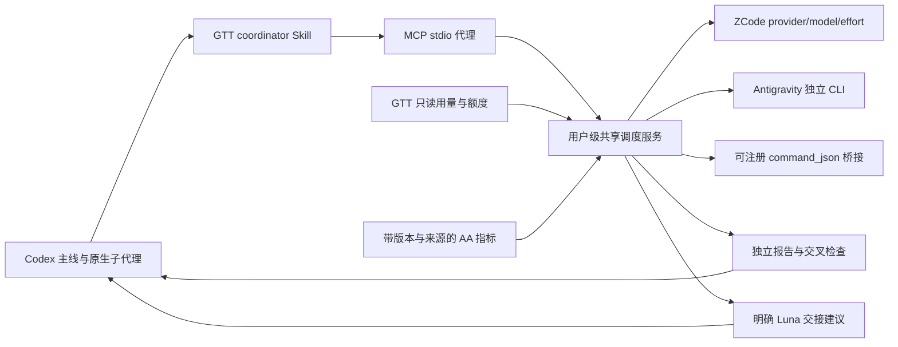

# 模型协同调度器

本仓库为 GTT 的独立协同组件：读取 GTT 的只读账本投影，调用已配置的外部软件，并通过 MCP/Skill 为 Codex 提供有界辅助报告。它不改变现有 Rust core、UI、扫描器或账本格式，不增加生产库依赖。



执行优先级是合格外部路线、其他合格外部来源、短排队宽限期、调用方 Luna 交接。调度器结合任务类型、质量门槛、剩余时间、来源容量、额度信号、实际调用健康和延迟；选择理由可回读。`work_key` 避免与 Codex 自身代理重复工作。扇出报告完整后才做互证，不使用只看过一份材料的 verifier 冒充完整交叉检查。

调用入口：

```powershell
python .\bootstrap.py --antigravity-cli <已验证的独立CLI绝对路径>
python .\router.py call --method router_inventory
python .\router.py mcp
```

本机配置、模型计费状态和运行记录在 `~/.globaltokentracker/router/`，不进入仓库。bootstrap 不覆盖现有配置；独立 CLI 复制到该目录而不修改全局 PATH。Antigravity 使用新建的协调器专用项目，并有每次任务的工具门禁，原有项目和全局设置不被修改。

生产代码只需要现有 Python 3.10+ 与各原生 CLI 的运行时。标准 MCP 线协议通过独立已安装的官方 Python MCP SDK 客户端验证，SDK 仅用于验收探针，不是生产依赖。

验证命令：

```powershell
python -W error::ResourceWarning -m unittest discover -s tests -v
python .\live_probe.py
```

`tests/mcp_protocol_probe.py` 使用独立 MCP SDK 验证两个客户端共用已有作业。它需要已安装的 SDK 和先前的 synthetic live job，不会为了验证协议额外提交模型任务。`live_probe.py` 会提交少量真实请求，因此不属于普通离线单元测试。

调度服务能保存计量与估算、取消、尝试上限及明确交接，但不能预知原生软件隐藏的系统提示词/思考 token，也不能自动读取没有额度接口的软件余额。质量分是决策先验，不是结果正确性的证明。GTT 的其他来源只有用量观察，并非已经有执行适配器；新执行源的契约见 [Skill 接入参考](../skill/references/integration.md)。

软件/提供商/模型的近期连通性失败单独降权，约 30 分钟半衰期自动衰减；累计失败不会永久封锁来源。恢复检查只占闲置容量，默认 30 分钟后开始、失败指数退避至 6 小时、每小时最多 2 次且限制独立 token 预算，前台工作到来即让出。检查必须完成一次小型生成，不用 models 列表代替。该检查不提升模型智力评分、不覆盖任务质量反馈。

官方依据：[Codex MCP](https://learn.chatgpt.com/docs/extend/mcp?surface=cli)、[MCP stdio 规范](https://modelcontextprotocol.io/specification/2025-11-25/basic/transports)、[Antigravity headless](https://www.antigravity.google/docs/cli/headless/)、[Antigravity hooks](https://www.antigravity.google/docs/hooks/)、[AA 数据 API](https://artificialanalysis.ai/data-api)。
