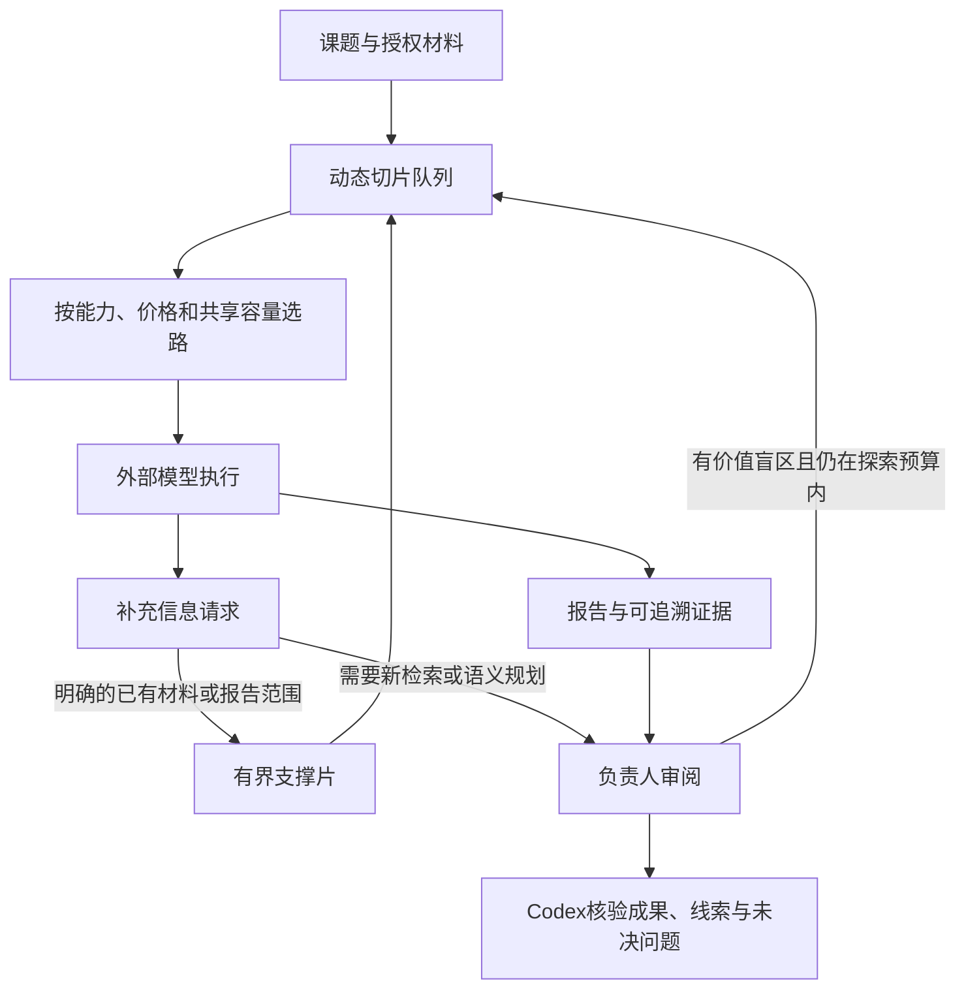

# 动态切片、信息支撑与受限探索

研究组把角色席位与工作项分开。默认slice_mode=adaptive；材料超过目标片长时，按段落/行分配互异字符范围，完成一片就补下一片。较短材料按负责人提出的具体任务分发。负责人也可显式指定context_range进行语义分工。机器切片保留所有字符，但不保证代码、JSON或跨段论证语义完整；成员须报告缺少的定义和依赖。



| 参数 | 默认 | 可设范围/用途 |
|---|---:|---|
| slice_target_chars | 12000 | 1000–64000，初始目标 |
| slice_min_chars | 2000 | 500–64000 |
| slice_max_chars | 32000 | 1000–128000，min ≤ target ≤ max |
| max_slices | 64 | 2–256，包含缩片父记录和支撑记录 |
| max_parallel | 未指定 | 1–32，本组并发；默认采用当前作用域建议 |
| output_mode | adaptive | adaptive / native |
| exploration_mode | guided | guided / off |
| max_exploration_rounds | 2 | 0–8，仍受组总轮数约束 |
| exploration_budget_ratio | 0.15 | 0–0.3，探索成员的累计预约与实际用量受此约束；负责人复核使用主线预算 |

后续未分配片在连续三次成功后可扩大25%；迟缓或明确截断时缩小。上下文容量进一步限制目标片长。截断/context_exceeded只分裂失败片，成功片保持；超时结果标unknown并交回调用方，不自动重放。全局、来源、provider、scope和Codex合计容量门槛始终有效，保留普通前台槽位。队列等待与模型首次活动计时分开。

每片保存源哈希、内容哈希、任务模板哈希、字符范围、父记录、worker与轮次。重启保留结果和计量，等待显式resume；已成功片不重发，尚未发出的片可继续。未知付费请求默认禁止重试，retry_unknown_slices=true是调用方接受可能重复费用的显式选项。累计记录上限或证据缺口不会伪装完整。

成员可以在报告JSON中提出：

```json
{
  "information_requests": [
    {
      "question": "需要调用方的错误处理定义",
      "reason": "当前片段无法确认异常是否被吞掉",
      "context_range": [18000, 19500],
      "report_workers": [3]
    }
  ],
  "research_leads": [
    {
      "question": "是否需要补查取消与持久化的竞态？",
      "rationale": "已有证据没有覆盖取消后迟到回复",
      "priority": "high",
      "expected_value": "发现重复执行或错误完成状态",
      "evidence_refs": []
    }
  ]
}
```

成员最多提出两条信息请求和两条线索。材料范围必须属于原context，报告ID必须已经存在。范围不等同当前输入、长度可控的本地支撑最多自动接续两层，并占用既有预算/切片/并发容量；问题本身没有明确范围或涉及新网页时，由负责人规划。每条请求获得worker:index形式的request_id，支撑任务明确携带原问题、原因和出处。响应保存responds_to_requests；分裂后的支撑需收齐其范围才关闭对应问题。

负责人可使用以下后续任务定向补查：

```json
{
  "role": "analyst",
  "kind": "logic_check",
  "prompt": "结合补充定义，重新检验异常传播路径",
  "context_range": [18000, 19500],
  "evidence_workers": [3, 8],
  "information_request_ids": ["3:0"]
}
```

负责人每轮最多提出max_slices项任务，工作项数不增加角色席位。报告摘录会明确excerpt_only及原worker；缺失完整证据应请求定向跟进或报回Codex。未得到支撑的信息请求会阻止submit_codex。收到支撑表示可以审阅，不证明结论正确。

排查结果与完整门禁关系见[调度耦合与可达性](scheduler-coupling-audit.md)。达到总轮数上限仍可续跑当前轮的待执行片；探索额度只约束探索成员，负责人复核不会因探索额度耗尽而失去主线预算。合组前须解决原组待执行片和信息请求，并保留来源并发/探索限制。

负责人主动检查盲区、反例和改进机会。存在具体且课题内有价值的线索时，返回continue_research、exploration=true、research_leads及互异next_tasks。guided探索受独立轮数和预算比例约束，不自动扩总预算、席位或课题。越界建议留作待审线索；线索不充分时允许收束。Codex仍负责最终成果与建议的核验。

新字段需要运行更新后的驻留服务及MCP schema。刷新目录仅更新模型快照，不会重载运行中的Python代码；升级共享服务前须确认没有需要保留的在途请求。
