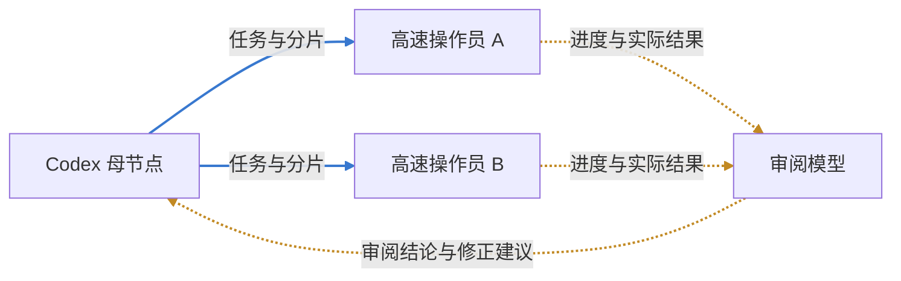

# Codex 母节点、操作员与回报拓扑

0.6.0 增加 `operator_workflow_v1` / `feedback_edges_v1`。真正的 Codex 调用方负责思考、完整拓扑切片、修正批准与最终验收；高速模型负责生成具体操作，GTT 可信工作区执行器负责实际落盘和运行明确授权的命令。原生模型工具仍保持禁用，不因添加一个模板而获得整台机器的操作权限。

## 节点与连线

| 节点 | 实际职责 |
|---|---|
| `codex` | 真实调用方桥接，不绑定外部路线、不自行启动或冒充 Codex；等待规划/确认/验收回执 |
| `operator` | 接收母节点指定的文件、分片和验收条件，输出具体操作批次；由本地执行器执行 |
| `reviewer` | 接收实际操作收据、操作前后文件证据与 diff，报告 `review.accepted` 和问题；没有修正授权 |
| 原有模型与本地节点 | 继续表示研究、提取、汇总、信息支撑、合并、门禁等，完整拓扑全部交给母节点查看 |



边结构为 `{from,to,kind:"task"|"report"}`。旧边缺省为 task，序列化可省略默认 kind。task 决定执行先后；report 传递进度、结果和审阅信息，不增加执行依赖入度。两种边分别无环，因此 `母→操作员(task)` 加 `操作员→母(report)` 合法，而同类循环、自环和同类重复边拒绝。回报可经过多个模型，不要求每段都是任务线的直接反向祖先。

Windows 和 macOS 都提供任务线、回报线及双向快捷方式。任务线使用主题强调色，回报使用琥珀/橙色，端口高度和路径分开并保留箭头；双向快捷方式原子加入两条不同种类的边。按顺序串联仅重建 task，不删除 report。

## 本次执行授权

授权跟随本次提交，不写进角色模板，也不能由模型扩大：

```json
{
  "kind": "workflow",
  "definition": {"完整工作流": "包含一个codex及所需operator/reviewer节点"},
  "input_text": "本次目标与有界原始材料",
  "workflow_id": "implementation-round-1",
  "execution": {
    "root": "D:/workspace/project",
    "writable_paths": ["src/example.py", "tests/test_example.py"],
    "commands": {},
    "max_file_bytes": 1048576,
    "max_operations": 32
  }
}
```

root 必须是现存绝对目录，writable_paths 必须是逐个列明的 POSIX 相对文件名，不接受整个目录、通配符、绝对路径、父级穿越或链接绕出。默认拒绝 `.git`、`.env`、凭证及密钥类路径。普通任务原有只读契约不变。

可选 commands 是母节点/调用方预先登记的固定 `{id:{argv,cwd,timeout_s}}`。操作员只能选择 command_id，不能追加参数或生成任意 shell；默认空表不运行命令。预授权程序本身属于可信本地代码，这不是操作系统沙箱，登记命令时应明确它的副作用与工作区范围。

## 母节点控制与多级分片

所有操作继续经统一 `router_dispatch`，提交仍必须提供稳定 request_id。新增动作：

- `topology`：返回完整任务/回报图、层级、角色、路线、全部节点状态、工作版本、授权范围、累计预算与待办。母节点看到的不只是操作员列表。
- `coordinate`：真实 Codex 调用方提供 expected_revision、唯一 event_id 和具体 decision。服务标明 caller_reported_codex / identity_verified=false，不声称认证了模型身份。
- `events`：按 cursor 回收持久进度、操作结果和审阅事件；重复投递不二次触发工作。事件不授予文件权限。

首次提交进入 `awaiting_codex`，不会把母节点自动标为已完成，也不会替调用方拉起另一层 Codex CLI。当前 Codex 读取拓扑后返回分片：

```json
{
  "type": "assign",
  "assignments": [
    {
      "node_id": "operator-a",
      "instruction": "按分片实现指定变更，不修改其他文件",
      "paths": ["src/example.py"],
      "command_ids": [],
      "input_range": [0, 2000],
      "acceptance": ["保留既有接口", "验证边界条件"]
    }
  ]
}
```

input_range 是本次输入材料的字符区间。母节点可以按完整拓扑逐级下发多个操作员；有依赖的下级等上级真实执行成功后才启动，并刷新文件基线。子操作员的文件和命令范围不能超过上级已获分配的范围。并行操作员应分配互不覆盖的文件；共享文件需要显式 task 依赖。状态变化、失败、冲突与预算都回到母节点，调度器不以模型消息擅自扩大工作范围。

大文件可用 `file_ranges:{"src/example.py":[20,80]}` 指定从 1 开始、两端包含的行区间。给操作员的正文只包含该片，哈希仍覆盖完整文件；片段文件仅允许在所给行内容内唯一匹配的 replace_text，禁止将片段当全文 write_text。子操作员行范围也不能扩大父范围，审阅的实际前后快照对应这些行区间。超过 48,000 字符的分配文件材料会要求继续切片，不会默默截断作为完整文件交付。

## 具体操作与真实审阅

操作员保留完整报告契约，并附加 operations，例如：

```json
{
  "summary": "生成指定替换操作，等待执行器实际执行",
  "findings": [], "sources": [], "uncertainties": [], "complete": true,
  "operations": [{
    "id": "replace-1", "op": "replace_text", "path": "src/example.py",
    "base_sha256": "分配快照中的完整文件SHA256",
    "old_text": "旧的准确文本", "new_text": "新的准确文本"
  }]
}
```

支持 write_text、唯一匹配的 replace_text 和已登记 run_command。创建新文件的 base_sha256 为 null，修改现存文件必须准确匹配基线。执行器先检查全批次路径、哈希、大小和身份，再按文件独占锁原子替换；实际写入和命令不再次计模型 tokens。

每项操作持久记录 prepared / applying / applied / conflict / unknown 等状态、前后 SHA、工作项及审批出处。同操作身份不重复执行、改内容报冲突；未知命令不自动重放。多文件不是天然事务，部分完成后的失败保留收据，不自动回滚覆盖其他修改。重启后未决操作保持未知，须对账。

审阅模型看到真实操作后的文件和 diff，而不是把操作员声称的“已修改”作为证据。它返回 `review:{accepted:boolean,issues:array}`。只收回报的审阅者等结果到达后才执行，不会因 task 图中零入度而抢先运行。

发现错误后进入母节点确认。`coordinate` 的 revise 决策必须绑定当前具体 proposal_digest、节点及新 assignment；未经确认不产生新操作。只重新执行被批准修正的工作项，保留其他已完成工作和累计费用；其他分支未解决的审阅不能因一次修正被清除。默认单节点最多 8 轮修正，可显式设 max_rounds 至 64，仍受累计 token 预算限制。

如果完整操作报告已付费生成，但文件步骤在实际落盘前被开关/模型池等已知门禁阻断，母节点可显式 `retry_operations`，绑定 node_id 和当前 proposal_digest。它复用原报告，不发新模型请求；仅支持文件操作，拒绝命令、未知结果及任何已改变的原始基线。各操作仍用新的审批身份重新校验。跨重启也只有这种已知失败的显式核对，或已完成证据的显式验收可继续，未知副作用不自动重放。

最终 accept 必须绑定当前完整证据的 evidence_digest，所有节点完成、审阅通过且无未解决信息请求。服务再次核对实际文件，不能用文件后来已改变的旧报告验收。接受与拒绝始终由真实 Codex 调用方明确回填。

## CLI

```powershell
globaltokentracker-cli scheduling topology --request-id 'implementation:1'
globaltokentracker-cli scheduling coordinate --request-id 'implementation:1' --expected-revision 0 --event-id 'plan:1' --decision-file 'D:\private\assignment.json'
globaltokentracker-cli scheduling events --request-id 'implementation:1' --cursor 0
```

拓扑、回报与存量结果读取走认证管理端点；新的分配、修正和验收必须遵守外协、调度、来源、有效模型池和可选监督配置。可视工作流可显式设置 luna_supervision=false，让当前真实 Codex 作为母节点控制，不伪造 Luna 监工。关闭开关不清除历史结果，也不会偷偷恢复未知操作。
