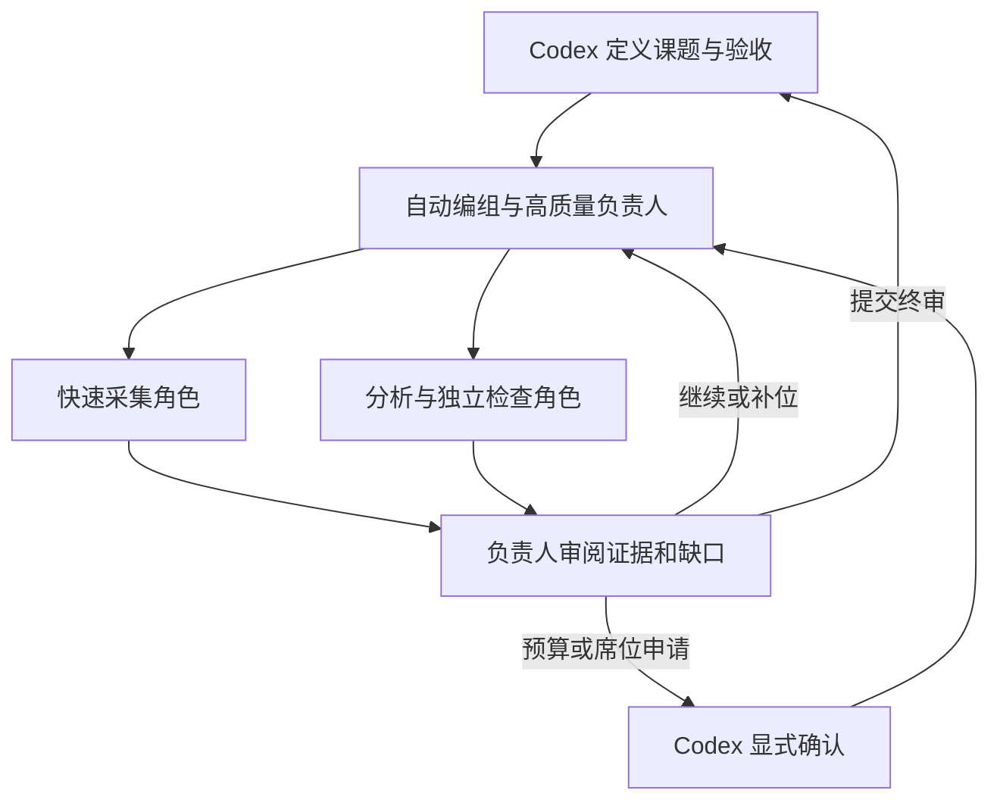

# 分组研究

研究组自动选择 3–8 个角色（包含负责人），允许跨软件、跨提供商及不同来源的同一模型。采集角色偏重速度；分析、反例检查和负责人维持较高质量门槛。依据仍是版本明确的能力参考、实测延迟、额度、近期健康与任务能力；模型清单或评分不能证明研究结论正确。

## 资源与质量

- 默认累计预算 50000000 tokens；只有负责人提出需要、Codex 显式批准后才扩展，最多 100000000。明确上报与保守估算分别展示，未知消耗不写成零。
- 默认adaptive按角色、材料规模与原生上限分配每次输出预算；output_mode=native明确采用原生输出上限，未知上限仍使用有限预算。没有固定每轮总配额，模型上下文和16MiB协议容量仍有效。给每组一个总预算不意味着必须耗尽它。
- 默认12轮/6小时，可设置最多64轮/7天；需要更多轮次时交给Codex，显式续跑最多扩至64轮。只有模型建议不会自动增加轮数、席位或预算。
- 默认3个执行组、32个在执行/排队/待审组；全局仍沿既有并发门限，并为普通主线保留一个槽位（全局只有一个槽时无法额外预留）。已经计费的调用正常结束，主线新预约优先。
- 连接、额度和限流失败沿既有来源/提供商/模型健康降权及恢复策略；失败请求可换合格来源。负责人可按证据给成员质量反馈与替换建议。暂时失败的显式补位暂避30分钟，质量不适合该课题的模型仅在本组排除，不永久禁用整个软件。

每轮报告保留争议、来源关联和缺失证据。负责人不能把缺少成员证据的轮次伪装完整；模型提出终审后仍等待 Codex 真实核对。负责人初审认为无需更多研究时可直接交 Codex，报告不会声称已经完成成员研究。

默认动态工作队列最多64个记录，可设至256；角色仍是3–8席，工作项多于席位不会自动申请增员。大材料按字符范围分片，附来源/内容/任务模板哈希；明确截断可以缩片，成功片保留。默认guided探索最多2轮且最多使用组预算的15%，发现有价值盲区可续研，研究线索持续上报。成员information_requests支持材料范围及已有报告，定向支撑最多自动接续两层，其他请求由负责人规划。完整协议见[动态调度](dynamic-scheduling.md)。

## MCP / 本地 API

服务提供12个普通/恢复/偏好工具和9个组工具：

| 方法 | 用途 |
|---|---|
| router_group_plan | 不生成模型回复的候选编组计划 |
| router_group_submit | 异步启动研究 |
| router_group_status | 紧凑进度、预算、席位和待确认动作 |
| router_group_collect | 分页回收报告，最多等待5秒 |
| router_group_cancel | 取消本组，保留迟到的明确用量 |
| router_group_extend | approved=true、理由与目标总预算；最高1亿 |
| router_group_adjust_seats | approved=true、理由与3–8个目标席位 |
| router_group_resume | Codex 明确继续，保留已付费证据 |
| router_group_complete | Codex 终审核对后接受或拒绝 |

外部容量不足的普通成员可明确交接调用方 Codex 子代理，沿 `router_complete_codex` 返回实际模型、报告和用量；此为调用方报告，GTT不声称验证过子代理能力。回报计入组预算，仍由负责人再审；负责人不能通过此路径被低质量模型自动替代。

当前聊天若尚未发现新工具，可使用本地 `router.py call --method <方法> --params-file <参数文件>`。参数文件留在本机私有目录，避免课题/上下文进入进程命令行。

## 持久化与边界

作业与计量共用原子保存；生成后先持久化明确用量，再校验报告。重启将活跃状态标 interrupted，保留已收费结果；未回报的调用标未知并保守估算，不自动重放。Codex显式恢复后先检查已有证据，缺口由负责人提出补查。取消与批准/续跑共用状态锁，取消的组不能被晚到回复复活。

组请求、报告和内部计划只保存在本机私有状态库，GTT账本仅消费脱敏计量表。没有新增生产依赖；只使用现有有界执行适配器。模型不获得执行本机命令、修改文件、任意授权资源或自行拉起新主代理的权限。

## 验证

初始研究组146项测试通过，覆盖预算/席位审批、共享预约、多组隔离、低质量与失败补位、主线预留槽、取消竞态、重启未知结果、已结算消耗不重算、调用方成员接力和完整证据终审。后续本轮偏好与恢复优化由全套回归另行验证；双官方MCP客户端当前确认21工具、共享偏好作用域、新建预算5000万与组计划接口。

真实3角色一轮验收最终使用 ZCode Step 负责人、Antigravity Flash采集及 ZCode Ling分析；OpenCode未完成的路线自动由合格来源补位。四份成功报告，组内累计可观测用量31265 tokens，无估算和残留预约。负责人识别了成员报告中的术语及返回合同问题，Codex独立验证后才标succeeded。实测也补回了成员原始课题上下文，并兼容无副作用的空操作数组；保存的有效终审决策可以重解析，不重新支付模型调用。此验收证明有界执行链路，不代表所有模型或所有研究课题质量已验证。
