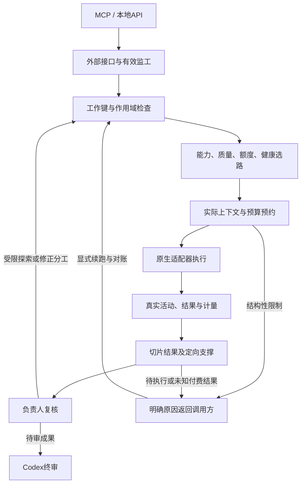

# 调度机制耦合与可达性排查

本次检查覆盖MCP/本地API入口、作用域与工作覆盖、路线选择、预约与计量、动态工作队列、信息支撑、探索、负责人复核、接力、恢复和合组。采用源码调用链核对、可复现的并发/故障测试、外部有界审阅及经用户授权的实际安装运行验收；各阶段边界分别记录。

## 已修复的连接断点

| 连接点 | 触发与原问题 | 修复后的路径 |
|---|---|---|
| 轮数与续跑 | 最后一轮还有待执行片，resume立即被round_limit拦住 | 完成现有轮次不增加轮数；开启新轮次仍受上限约束 |
| 初始规划与重启 | 角色已经写入、规划报告已付费保存，但下一步任务尚未落盘 | 复用已保存规划；已知无效规划的显式重试与中断恢复分开 |
| 作用域与队列 | scope满额只等硬截止，忽略调用方等待窗；后续可能误报模型超时 | 排队和预约阶段分别受queue_wait_s约束，返回scope_capacity_full且不交接新Codex任务 |
| 上下文与选路 | 原材料适合模型，实际包装后无生成余量，却反复等容量 | 以实际prompt复核上下文；context_exceeded返回切片路径，不计量未发出的请求 |
| 预算与容量 | 首选路线太贵，另一条合格路线只是暂时忙，作业却直接失败 | 区分永久预算不足、临时预约和容量等待，等待可负担路线释放 |
| 同用途覆盖与晚登记 | 提交后Codex接管同work_key，发出前未再查重 | 每次预约再次验证覆盖，work_already_covered停止新外部请求 |
| 请求与支撑 | 同一报告的两条请求共用worker，完成一条便把两条都关闭 | 每条请求获得request_id，支撑绑定information_request_ids |
| 支撑与分裂 | 支撑片分裂后第一份成功报告可能提前关闭整个问题 | 同一support范围的成功子区间需完整覆盖，缺口保持待支撑 |
| 请求编号与实际材料 | 支撑ID只存在调度属性，模型可能未收到问题本身 | support_requests明确传入原问题、原因与出处；仅ID支撑不会附带整份材料 |
| 消息、线索与请求 | 错误的可选沟通或线索会连带把合法信息请求标为无效 | 分别验证、发布和记录错误；事件饱和标缺口，不改变报告合法性 |
| 探索与主线 | 探索开始后的所有调用被永久限制在探索额度内 | 探索成员单独预约/计量/释放；负责人复核使用主线预算，主线修复保持可达 |
| 控制与合组 | 控制先锁groups、再取capacity，合组顺序相反 | 统一capacity → groups → job.changed → store的顺序 |
| 任务与角色席位 | 支撑/缩片映射到原席位后改写其长期角色，后续采集职责可能消失 | 动态工作项保留实际role，持续角色席位保持原定义 |
| 合组与未完成工作 | 合组把有待执行片/未解决问题的来源永久封存 | 原片和信息请求先完成/对账，再合组；来源报告仍只计量一次 |
| 合组与调用方限制 | 新组回到默认值，来源max_parallel、探索关闭等限制丢失 | 继承显式并发上限和保守探索约束、原生输出模式及已有探索消耗 |
| 无效分工与复核 | 不存在的报告引用留下running片，续跑反复卡住 | 形成不计费的invalid_member_task结果交负责人修正；越界范围在规划验证时拒绝 |
| 冷启动与缓存复核 | 已保存的负责人决策跳过规划，直接对尚未加载的目录派发，误报无路线 | 执行入口先刷新目录，复用已付费报告与缓存决策，保留质量及恢复门槛 |
| 大报告与原生请求 | 提示容量、解析上限、原生帧和OpenCode标准请求上限不同步 | report_max_chars显式连接报告容量；批准输出通过原生运行参数进入标准请求 |
| EOF与缩片 | 原生stop携带不闭合JSON，普通协议换源可能重复整个大切片 | 精确incomplete_json交回缩片队列；保留原生stop、失败费用及成功子片 |
| 聚合与支撑 | 大组需引用多份已完成报告，但4份引用/4问题限制拒绝合法聚合 | 32份报告/8问题、共享14000字符摘录；精确交付事件与逐问题状态 |
| 提取与正文提示 | 切片含5个案例，通用4条finding提示诱导遗漏 | 组提取允许16条finding，记录可分组；不得以条数约束省略所请求记录 |
| 消息与游标 | 大事件卡住cursor；消息摘要被裁剪却像完整证据 | 有界省略推进cursor，摘要裁剪标原长度/事件出处；原记录保持 |
| 活动与组终态 | 已完成worker在其他工作期间或组终审后继续增长静默年龄 | 每个终态attempt冻结，后续组更新时间不覆盖更早完成时间 |
| 启动阶段与等待 | native_phase先到、正文未到时，idle规则反而缩短首次响应窗 | 保留初始等待窗，真实正文/推理/工具响应后才沿空闲规则处理；硬截止始终生效 |
| 输出历史与ETA | 长输出耗时按短提取输入比例继续放大，派发前误报超时 | 已报告的输出主导历史与较小输出上限共同修正ETA；未知计量、逻辑任务与大输出保留原估计 |
| 零占位与预算恢复 | 未完成OpenCode消息全零tokens被误当真实零消耗 | 无可靠计量按预约估算，旧超时零占位幂等补记；原值/去重ID保留，达到预算后进入可审批门禁 |
| 冗余绑定与协议 | 负责人顶层重复已在next_tasks绑定的问题ID，整个决策被拒绝 | 仅完全等于任务绑定并集的有界唯一列表可规范化，不能隐含关闭问题或接纳额外ID |
| 完成报告与引用元数据 | 引用携带任务开始时复制的running状态，与已完成报告冲突 | 引用视图去除过期state，范围/哈希及完整原记录保留 |

## 可达性与门禁

关闭接口、无有效监工、质量/能力未达标、恢复隔离、额度不足和未知付费结果都属于受控门禁。失败理由与候选范围保留；不会把这些受限状态当作已完成工作。普通任务和研究组预算各自记账，workflow共享容量与来源状态，不存在隐含的workflow总Token余额。

信息请求的稳定标识为worker:index，原问题和支撑材料在同一个受限任务中投递。单问题旧报告的worker关联保留兼容；多问题需精确绑定。支撑完成仅表示相关材料已回报，负责人及Codex仍需核验推理。

## 验证与运行边界

21项专项测试位于[调度耦合测试](../tests/test_scheduler_coupling.py)，涵盖上表中的并发、恢复、计量和数据投递；全套295项通过，结果记录在[验证范围](verification.md)。外部审阅仅作候选证据，相关问题已独立复现；真实辅助审阅使用当前旧驻留服务，不能证明新调度已上线。

2026-10-12经用户授权完成共享服务与Skill切换，常驻health读回0.3.0/协议2，实际安装入口的两个MCP客户端、新参数计划及一次65536输出上限的真实逻辑任务通过验收；用量计账、预约归零、完整报告和slot反馈规范化均核对。具体证据边界见[验证范围](verification.md)。

后续0.3.2冷启动缓存续跑、真实免费/低价切片分发、补位支撑及完整大报告已执行；全部路线与512k真实生成没有因此获得通过结论。具体运行结果见[验证范围](verification.md)。

2026-10-13最终335项回归与25项耦合专项通过，安装运行副本及双客户端复验通过。真实组保留9个未知结果和8条未解决信息请求，旧零占位对账后停在预算审批入口；无自动扩预算或未知结果重放。合法31500记录的512k近上限生成仍返回不完整正文，未验收为成功。

保留的边界：自动切片不保证语法独立；ETA、价格与能力参考不等于成果正确性；未知原生Token只能保守估算；不能承诺每个CLI严格遵守生成预算。扩大并发的建议由新队列/轮次采用，作用域收紧则由每次预约实时检查。
